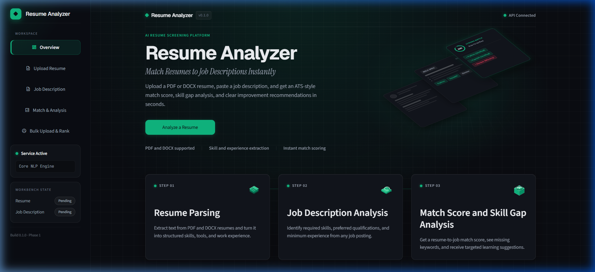
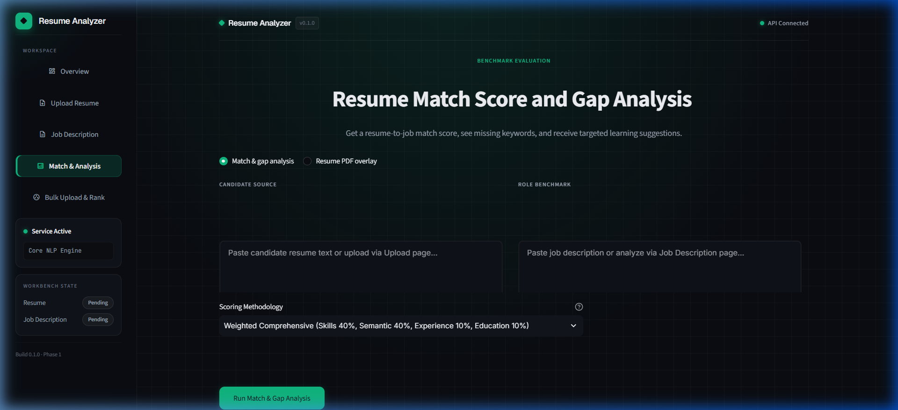
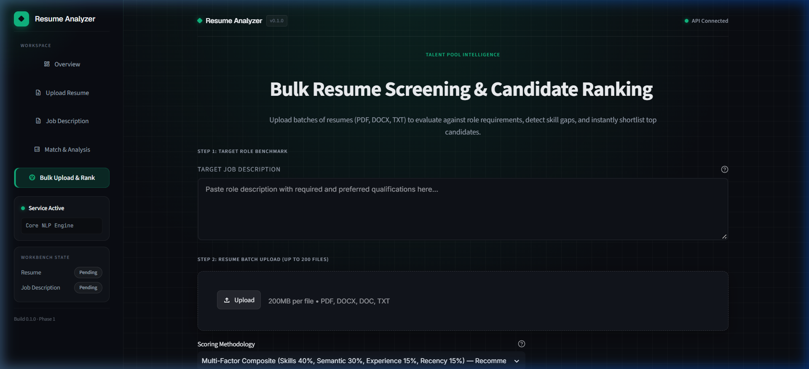

# Resume Analyzer

<p align="center">
  <strong>Production-grade AI-powered resume parser, semantic job matcher, and blind candidate screening engine.</strong>
</p>

<p align="center">
  <a href="https://www.python.org/"></a>
  <a href="https://fastapi.tiangolo.com/"></a>
  <a href="https://streamlit.io/"></a>
  <a href="https://spacy.io/"></a>
  <a href="tests/"></a>
  <a href="LICENSE"></a>
</p>

---

## What it does

Resume Analyzer is an intelligent recruitment analytics system that parses PDF and DOCX resumes, extracts structured candidate profiles (identity, skills, education, and dates), and benchmarks them against job descriptions. It scores candidate-job alignment across four configurable scoring models combining canonical taxonomy matching, sentence-transformer semantic embeddings, evidence depth verification, and exponential recency decay. The platform provides an interactive Streamlit multi-page dashboard alongside a high-performance RESTful FastAPI backend supporting batch candidate ranking, blind-screening PII redaction, and deterministic STAR bullet optimization.

---

## Screenshots

### 1. Overview Workspace


### 2. Match & Gap Analysis


### 3. Bulk Upload & Candidate Ranking


---

## Features

- [x] **Dual Document Ingestion**: Parses `.pdf` (via PyMuPDF) and `.docx` (via python-docx) documents with candidate contact extraction (emails, phone numbers, LinkedIn/GitHub links).
- [x] **Canonical Skill Taxonomy**: Hybrid dictionary and contextual NLP matching against 220 canonical skills across 8 categories with 388 surface aliases, protected by negative context rejection guards.
- [x] **Structured Job Description Parsing**: Deconstructs raw JD text into required qualifications, responsibilities, and preferences, inferring target experience thresholds and degree requirements.
- [x] **Dense Semantic Embedding Similarity**: Evaluates conceptual overlap between resume chunks and job descriptions using Sentence Transformers (`all-MiniLM-L6-v2`) with cosine similarity and TF-IDF fallback.
- [x] **Skill Evidence Depth Analysis**: Inspects the grammatical context of matched skills, classifying evidence into `high_depth` (action verb + metric), `demonstrated` (action verb), or `listed` (mention only).
- [x] **Exponential Skill Recency Decay**: Weights candidate skills by recency of active application across career positions using exponential half-life modeling.
- [x] **Experience Normalization & Calendar Merging**: Resolves overlapping date intervals, parses diverse date formats ("MM/YYYY", "Month YYYY", "Present"), and differentiates standard employment from freelance work.
- [x] **Education Tier Verification**: Extracts degree levels (Doctorate, Master's, Bachelor's, Associate) and fields of study with false-positive safeguards against common homoglyphs.
- [x] **Multi-Model Scoring Presets**: Configurable scoring presets (`skills_only`, `hybrid`, `proposal`, `composite`) with transparent sub-score breakdowns and qualification status flags.
- [x] **Batch Upload & Top-N Shortlisting**: Processes multiple candidate files in parallel, ranks them with deterministic multi-level tie-breaking, and exports shortlisted candidates to CSV.
- [x] **Blind Screening & PII Anonymization**: Heuristically redacts candidate names, emails, phones, URLs, and gendered pronouns with residual leakage checking and sanitized dossier export.
- [x] **Interactive PDF Visual Overlay**: Generates coordinate-accurate PDF highlight overlays displaying matched skills, missing requirements, and high-depth evidence directly on the original document.
- [x] **Rule-Based STAR Bullet Optimizer**: Offline, deterministic bullet rewriter analyzing action-verb strength, measurable metrics, and domain-relevant achievements without external LLM dependencies.
- [x] **Job Role Classification**: Recommends top matching job families using a trained scikit-learn classifier pipeline with confidence probability scores.

---

## Tech Stack

| Layer | Technology | Purpose |
| :--- | :--- | :--- |
| **API Framework** | FastAPI (>=0.110.0) | High-performance asynchronous REST API routing and OpenAPI documentation |
| **ASGI Web Server** | Uvicorn (>=0.28.0) | Production-grade asynchronous server for hosting the FastAPI backend |
| **User Interface** | Streamlit (>=1.35.0) | Interactive multi-page dashboard for analysis, ranking, and visualization |
| **Document Parsing** | PyMuPDF / fitz (>=1.24.0) | High-speed PDF text, layout, and visual coordinate bounding-box extraction |
| **Word Parsing** | python-docx (>=1.1.0) | Microsoft Word `.docx` text and structural paragraph extraction |
| **Linguistic NLP** | spaCy / en_core_web_sm (>=3.7.0) | Tokenization, dependency parsing, part-of-speech tagging, and entity extraction |
| **Text Processing** | NLTK (>=3.8.0) | Token normalization, stopword filtering, and sentence boundary segmentation |
| **Semantic Matching** | Sentence-Transformers (>=2.2.0) | Dense vector chunk embeddings using `all-MiniLM-L6-v2` |
| **Machine Learning** | scikit-learn (>=1.4.0) | TF-IDF vectorization, cosine similarity computation, and job-role classification |
| **Data & Array Math** | NumPy (>=1.24.0) & Pandas (>=2.0.0) | Matrix operations, date interval arithmetic, and tabular ranking manipulation |
| **Model Serialization**| joblib (>=1.3.0) | Loading serialized job-role classification models (`job_classifier.joblib`) |
| **Validation** | Pydantic (>=2.7.0) | Strict schema validation and data modeling for requests and responses |
| **Testing** | pytest (>=7.4.0) & httpx (>=0.27.0) | Comprehensive unit, integration, edge-case, and endpoint test coverage |

---

## Project Structure

```text
resume-analyzer/
├── app/
│   ├── data/
│   │   ├── resume_dataset.csv         # Training and evaluation resume corpus
│   │   ├── skills.json                # Canonical taxonomy of 220 skills and 388 aliases across 8 categories
│   │   └── star_templates.json        # Action verb categories and metric template patterns for STAR rewriting
│   ├── models/
│   │   └── job_classifier.joblib      # Serialized scikit-learn job-role recommendation model
│   ├── __init__.py                    # App package initialization
│   ├── evidence.py                    # Feature 3: Grammatical action verb and metric evidence depth classifier
│   ├── experience.py                  # Work/freelance extraction, calendar interval merging, and duration formatting
│   ├── main.py                        # FastAPI application setup, middleware, and core API endpoints
│   ├── matcher.py                     # Sentence-Transformers semantic embedding similarity engine with TF-IDF fallback
│   ├── overlay.py                     # Visual PDF overlay builder mapping keyword matches to PyMuPDF bounding boxes
│   ├── parser.py                      # Multi-format document parser extracting text, email, phone, and links
│   ├── preprocess.py                  # Two-tier text cleaning (light_clean for embeddings, nlp_process for linguistic tokens)
│   ├── ranker.py                      # Multi-candidate sorting engine with deterministic score and experience tie-breaking
│   ├── recency.py                     # Feature 6: Exponential half-life decay modeling for skill application recency
│   ├── recommender.py                 # Job-role prediction and skill gap learning path recommendation logic
│   ├── redact.py                      # Heuristic PII anonymizer redacting names, contacts, and pronouns for blind screening
│   ├── routers_blind.py               # API sub-router for anonymization and candidate dossier generation endpoints
│   ├── routers_extra.py               # API sub-router for evidence depth and visual PDF overlay endpoints
│   ├── routers_star.py                # API sub-router for deterministic STAR bullet optimization endpoints
│   ├── scoring.py                     # Centralized scoring engine computing match scores across 4 configurable presets
│   ├── skills.py                      # Hybrid skill extraction, education parsing, and JD section deconstruction
│   └── star.py                        # Rule-based offline optimizer rewriting weak resume bullet points
├── dashboard/
│   ├── app.py                         # Multi-page Streamlit dashboard (Overview, Upload, JD, Match, Bulk Rank)
│   └── style.css                      # Custom SaaS theme styling, badge design, and layout rules for Streamlit
├── docs/
│   ├── figures/                       # Empirical evaluation plots (ablation studies, scatter charts, grid search)
│   ├── screenshots/                   # Dashboard UI screenshots (Overview, Match Analysis, Bulk Ranking)
│   ├── EVAL_NOTES.md                  # Comprehensive empirical evaluation notes and model benchmarks
│   └── NOTES_features_ui.md           # UI design documentation and interaction specifications
├── scripts/
│   ├── artifacts/                     # Evaluation confusion matrices and performance metrics
│   ├── compare_matching_modes.py      # Behavioral audit comparing scoring presets against test candidates
│   ├── eval_v2_resumes.py             # Evaluation runner assessing parser accuracy across v2 test resumes
│   ├── evaluate_matching.py           # Quantitative evaluation measuring rank correlations across scoring modes
│   ├── evaluate_redaction.py          # Benchmark measuring PII redaction precision, recall, and over-redaction
│   ├── evaluate_role_classifier.py    # Multi-class role classifier evaluation against external resume datasets
│   ├── evaluate_skills.py             # Precision and recall benchmark for dictionary and NLP skill extraction
│   ├── suggest_skills.py              # Discovery utility scanning resume corpuses for emerging skill taxonomy candidates
│   ├── test_scoring_recency.py        # Verification runner for scoring engine components and recency decay factors
│   ├── train_v2_model.py              # Retraining pipeline for the job-role classifier model
│   ├── tune_weights.py                # Grid search script optimizing scoring component weights against human evaluations
│   ├── verify_candidate_match.py      # Verification script auditing edge cases in experience and recency scoring
│   ├── verify_match_pipeline.py       # End-to-end audit verifying candidate matching across real JD fixtures
│   └── verify_scoring_modes.py        # Validation script checking mathematical bounds across all scoring presets
├── tests/
│   ├── eval/                          # Quantitative validation datasets and scoring ground truth
│   ├── fixtures/                      # Sample resumes (PDF/DOCX) and benchmark job descriptions
│   ├── generate_fixtures.py           # Fixture generator creating synthetic resumes for bulk ranking tests
│   ├── test_api_endpoints.py          # Integration tests for core FastAPI endpoints via TestClient
│   ├── test_blind_endpoint.py         # Tests for /resume/anonymize and /resume/dossier blind screening endpoints
│   ├── test_bulk_and_ranking.py       # Unit and integration tests for bulk ingestion, scoring, and tie-breaking
│   ├── test_cors.py                   # Verification tests for CORS middleware and ALLOWED_ORIGINS handling
│   ├── test_edge_cases.py             # Resiliency tests for corrupted files, empty inputs, and unusual characters
│   ├── test_evidence.py               # Tests for action verb extraction, metric detection, and evidence depth scoring
│   ├── test_experience_extraction.py  # Unit tests for date parsing, interval merging, and duration calculations
│   ├── test_fixtures_suite.py         # Comprehensive suite executing full bulk analysis across all 27 test fixtures
│   ├── test_identity.py               # Tests verifying candidate name inference, email, phone, and link extraction
│   ├── test_jd_analysis.py            # Unit tests for analyze_job_description section splitting and title inference
│   ├── test_matcher.py                # Tests for dense semantic similarity, normalization bounds, and TF-IDF fallback
│   ├── test_overlay.py                # Visual PDF coordinate overlay bounding-box generation tests
│   ├── test_parser.py                 # Multi-format document parsing tests covering PDF and DOCX extractions
│   ├── test_preprocess.py             # Unit tests for light_clean and nlp_process normalization pipelines
│   ├── test_recency.py                # Tests verifying date-based skill recency scoring and exponential decay factors
│   ├── test_recommend_endpoint.py     # Tests for the POST /recommend-roles classification endpoint
│   ├── test_recommender.py            # Unit tests for job-role prediction model loading and probability scoring
│   ├── test_redact.py                 # Unit tests for regex- and NER-based PII redaction and pronoun replacement
│   ├── test_role_match_and_eligibility.py # End-to-end benchmark tests evaluating candidate eligibility against JDs
│   ├── test_scoring.py                # Unit tests for all scoring modes, degree comparisons, and score breakdowns
│   ├── test_skill_abbreviations.py    # Regression tests validating normalization of acronyms and compound skill names
│   ├── test_skills.py                 # Unit tests for skill extraction, education parsing, and negative context guards
│   ├── test_star.py                   # Unit tests for weak bullet detection, action verb matching, and STAR rewriting
│   ├── test_star_endpoint.py          # Integration tests for the POST /resume/star-rewrite endpoint
│   ├── test_suggest_skills.py         # Unit tests for taxonomy discovery and candidate frequency suggestions
│   ├── test_upload_flow.py            # Verification tests for document upload, extraction, and matching workflows
│   └── ui_verification.py             # Headless browser verification script testing Streamlit UI elements
├── pytest.ini                         # Pytest configuration, warning filters, and test discovery settings
└── requirements.txt                   # Complete project dependencies for backend, NLP, ML, dashboard, and testing
```

---

## Quick Start

```bash
git clone <repo>
cd resume-analyzer
python -m venv .venv
.\.venv\Scripts\Activate.ps1
pip install -r requirements.txt
python -m spacy download en_core_web_sm
uvicorn app.main:app --host 127.0.0.1 --port 8000 --reload
streamlit run dashboard/app.py --server.port 8501
python -m pytest -q
```

---

## Scoring Modes

The scoring engine (`app/scoring.py`) supports four distinct scoring presets configured via `SCORING_CONFIG`. Each mode balances taxonomy coverage, semantic similarity, verified experience, education qualification, and skill recency:

| Mode | Skill Overlap | Semantic Similarity | Experience Fit | Education Fit | Skill Recency | Purpose & Intended Use Case |
| :--- | :---: | :---: | :---: | :---: | :---: | :--- |
| **`skills_only`** | 100% | 0% | 0% | 0% | 0% | Strict keyword & canonical skill overlap without semantic inference. |
| **`hybrid`** | 70% | 30% | 0% | 0% | 0% | Balances explicit skill matches with contextual semantic similarity. |
| **`proposal`** | 40% | 40% | 10% | 10% | 0% | Comprehensive holistic evaluation incorporating years of experience and degree rank. |
| **`composite`** | 40% | 30% | 15% | 0% | 15% | Advanced multi-factor evaluation with evidence depth weighting and exponential recency decay. |

### Evidence Depth Multipliers (`composite` mode)
When operating in `composite` mode, matched skills are weighted by the grammatical depth of evidence found in the resume:
- **`high_depth` (1.0x)**: The skill is governed by an action verb and includes measurable metrics (e.g., percentages, dollar amounts, scale).
- **`demonstrated` (0.85x)**: The skill is governed by a strong action verb without explicit metrics.
- **`listed` (0.50x)**: The skill is merely listed in a skills section or summary without context.

Semantic scores are normalized against configured bounds (`DEFAULT_SEMANTIC_LOW = 0.20`, `DEFAULT_SEMANTIC_HIGH = 0.65`) before component weighting.

---

## API Endpoints

The FastAPI backend exposes endpoints organized across dedicated functional tags:

| Method | Path | What it does |
| :--- | :--- | :--- |
| `GET` | `/` | Health check endpoint returning API operational status and version |
| `GET` | `/health` | Dedicated liveness and readiness probe for orchestration environments |
| `POST` | `/resume/upload` | Ingests PDF/DOCX files, parses full text, candidate contact info, and extracted skills |
| `POST` | `/job/analyze` | Deconstructs job description text into required skills, role titles, and experience bounds |
| `POST` | `/match` | Computes candidate-job match score across chosen preset with full component breakdowns |
| `GET` | `/skill-gap` | Compares resume skills against JD requirements to return missing and matched skills |
| `GET` | `/recommendations` | Suggests targeted skills to learn based on missing requirements from gap analysis |
| `POST` | `/recommend-roles` | Classifies resume text to predict top fitting job roles with probability scores |
| `POST` | `/resume/bulk-analyze` | Analyzes multiple uploaded resumes concurrently against a single target job description |
| `POST` | `/rank` | Sorts analyzed candidate profiles by match score with deterministic tie-breaking |
| `POST` | `/export/csv` | Generates and exports a downloadable CSV summary of ranked candidate shortlists |
| `POST` | `/resume/star-rewrite` | Re-engineers resume bullet points into structured STAR format with domain metrics |
| `POST` | `/resume/evidence` | Extracts sentence-level evidence snippets and classifies depth for matched skills |
| `POST` | `/resume/overlay` | Produces coordinate-level bounding box annotations for interactive visual PDF overlay |
| `POST` | `/resume/anonymize` | Redacts personally identifiable information (names, emails, phones, pronouns) |
| `POST` | `/resume/dossier` | Generates a sanitized blind-screening candidate dossier stripped of demographic identifiers |

---

## Environment Variables

| Variable | Default | Purpose |
| :--- | :--- | :--- |
| `SCORING_MODE` | `"composite"` *(in `app/main.py`)* / `"skills_only"` *(in `app/scoring.py`)* | Active scoring preset used for match evaluations (`skills_only`, `hybrid`, `proposal`, `composite`) |
| `SEMANTIC_SCORE_LOW` | `0.20` | Lower bound for min-max scaling of raw cosine similarity values |
| `SEMANTIC_SCORE_HIGH` | `0.65` | Upper bound for min-max scaling of raw cosine similarity values |
| `USE_LIGHTWEIGHT_MATCHER` | `"0"` | When set to `"1"`, disables heavy Sentence Transformers and falls back to TF-IDF vectorization |
| `ALLOWED_ORIGINS` | `None` *(wildcard/default)* | Comma-separated list of allowed origins for FastAPI CORS middleware |
| `API_BASE` / `BACKEND_URL` | `"http://localhost:8000"` / `"http://127.0.0.1:8000"` | Base URL of the FastAPI backend consumed by the Streamlit dashboard |

---

## Live Demo

- **Interactive Streamlit Dashboard**: [http://localhost:8501](http://localhost:8501)
- **FastAPI Interactive Swagger Docs**: [http://localhost:8000/docs](http://localhost:8000/docs)
- **FastAPI ReDoc Specification**: [http://localhost:8000/redoc](http://localhost:8000/redoc)

---

## Test Coverage

The project maintains test coverage across 26 test files:
- **Total Test Files**: 26 suites in `tests/`
- **Total Tests Collected & Passing**: 530 tests
- **Pytest Collection Command**:
  ```bash
  python -m pytest --collect-only -q
  # Output: 530 tests collected
  ```

---

## Known Limitations

- **No OCR for Scanned Documents**: Document text extraction via PyMuPDF and python-docx relies entirely on embedded text layers; flattened image-only PDFs or scanned page images yield empty text without external OCR preprocessing.
- **English-Centric NLP Models**: The skill taxonomy, linguistic dependency patterns, date parsing rules, and degree regexes are built specifically for English resumes; non-English resumes or international date conventions are not natively supported.
- **Heuristic Redaction Limitations**: Blind screening uses statistical NER and pattern matching to redact PII, which cannot guarantee 100% anonymity if candidate names appear in irregular non-standard grammatical contexts or embedded graphics.
- **Calendar-Based Experience Approximation**: Experience extraction aggregates chronological date intervals without accounting for part-time versus full-time allocations, career breaks, or concurrent non-additive commitments.
- **Stateless In-Memory Architecture**: The backend operates statelessly without an external relational database (e.g., PostgreSQL); bulk upload batches and candidate dossiers reside strictly in transient memory and session state.

---

## License

This project is licensed under the [MIT License](LICENSE).
